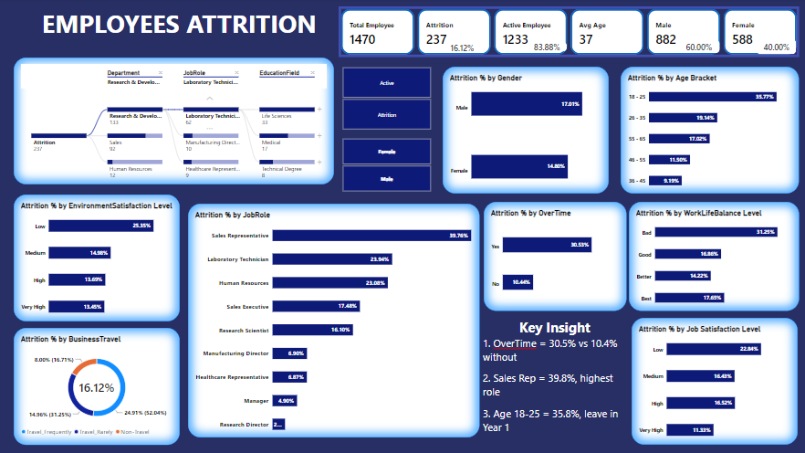

# Employee Attrition Dashboard | Power BI

## 📊 Project Overview
This project analyses employee attrition to find out **why employees are leaving** and **what to fix first**.

Built in Power BI from HR data. The dashboard turns raw HR records into a clear story for managers.

**Dataset:** HR Employee Attrition Dataset
**Total Employees:** 1,470
**Employees Left:** 237
**Overall Attrition Rate:** 16.12%

## 📸 Dashboard Preview

## 🔍 Key Insights

**1. OverTime is the biggest driver**
Employees working OverTime leave at **30.5%** vs **10.4%** for those without OverTime.
That is almost 3x more likely to leave.

**2. Sales Rep is the highest-risk role**
Sales Rep has the highest attrition at **39.8%**, followed by other roles.
This role needs urgent review of targets, workload and support.

**3. Young employees leave the most**
Age group **18-25** has the highest attrition at **35.8%**.
This group needs better onboarding and mentoring.

**Other patterns found:**
- WorkLifeBalance = Bad: **31.25%** attrition
- Job Satisfaction = Low: **25.29%** attrition
- Environment Satisfaction = Low: **25.29%** attrition
- Marital Status = Single: **25.53%** attrition

## ✅ Recommendations: What To Fix First

**1. Fix OverTime**
Cap OverTime at 10 hours per week. Require manager approval. Give time off in lieu for every 10 hours of OverTime.
Target: Reduce OverTime attrition from 30.5% to under 15% in 6 months.

**2. Fix Sales Rep Role**
Review Sales Rep targets and pay. Add a buddy / mentor for the first 3 months. Replace warnings with coaching for missed targets.
Target: Reduce Sales Rep attrition from 39.8% to under 25% in 12 months.

**3. Fix Onboarding for 18-25**
Create a 90-day onboarding plan with check-ins at Day 30, 60 and 90. Pair every new hire with a senior employee.
Target: Reduce 18-25 attrition from 35.8% to under 20% in 12 months.

**Summary:** If we fix OverTime for Sales Reps aged 18-25 first, overall attrition will drop the fastest.

## 📁 Files in this Repo

| File | Description |
| --- | --- |
| Employee_Attrition_Dataset.pbix | Power BI Dashboard File - Open in Power BI Desktop |
| Employee_Attrition_Dashboard.png | Dashboard Screenshot / Export |
| Amdor analytics Attrition.xlsx | Cleaned Excel Data Used for Analysis |
| Employee_Attrition_Recommendation... | Full Written Recommendations Document |

## 🛠️ Tools Used
- Power BI Desktop
- DAX for Attrition % measures
- Excel for Data Cleaning

## 📈 How Attrition % Was Calculated
Attrition % = Employees Who Left / Total Employees in that group

Example: OverTime Yes = 30.53% means 30.53% of all employees who worked OverTime left the company.

## 👤 Author
Amdor Analytics
